# CLOT-LESS: testing a clot-dissolving drug in parabolic flight

A student-built microfluidic payload that perfused tenecteplase (TNKase) and a water control through real blood clots during zero-gravity parabolas, while logging pressure, acceleration and video. Flown on the NRC Falcon 20 during CAN-RGX 9 (Ottawa, September 2026).

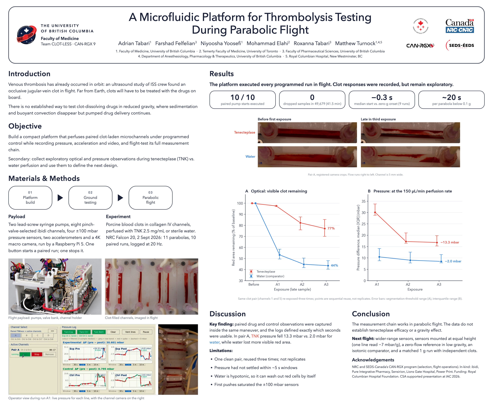

*One-page overview. [PDF version](poster/CLOT-LESS_overview_poster.pdf).*

---

## Why this experiment

Venous thrombosis has already happened in orbit. An ultrasound study of ISS crew found an occlusive jugular-vein clot during flight, and the crewmember had to be treated in orbit. On a mission to the Moon or Mars, the drugs on board will be the only option.

Nobody has a standard way to test clot-dissolving drugs in reduced gravity. Red cells stop settling and buoyant convection disappears, but a pump still pushes drug into the clot. CLOT-LESS was built to find out whether that question can be measured at all inside a 20-second parabola, and what it takes to do it properly.

**My role:** project lead and mission specialist. I coordinated the project from concept through procurement, build and the flight campaign, led the experimental design and clot-model development, and presented the work at IAC 2026.

## At a glance

| | |
|---|---|
| Platform | 2 syringe pumps, 8 pinch-valve-selected microfluidic channels, 4 pressure sensors, 2 accelerometers, 4K macro camera, Raspberry Pi 5 |
| Sample | Porcine blood clots in collagen IV-coated ibidi channels |
| Arms | Tenecteplase 2.5 mg/mL vs. sterile water, run as simultaneous pairs |
| Flight | 11 parabolas, 10 paired pump starts, 41.5 min logged at 20 Hz |
| Reliability | 10/10 programmed starts executed, 0 dropped samples out of 49,679 |
| Timing | 9 starts at zero-g onset, median 0.3 s before it |
| Outcome | Measurement chain proven in flight. Clot data exploratory. A clear list of fixes for the next flight |

## 1. The payload

<p align="center">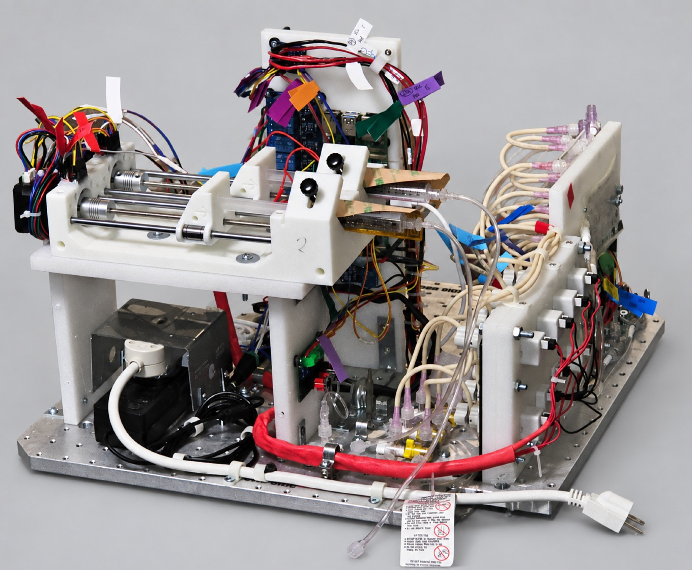 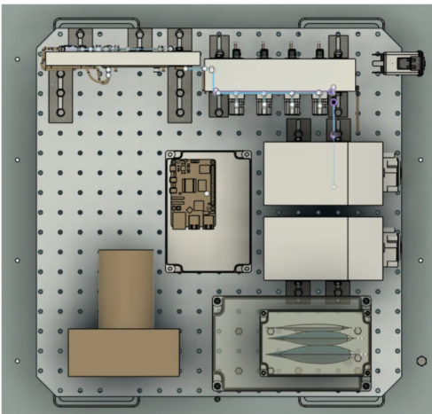</p>

Everything bolts to a 45.5 × 45.5 cm aluminium baseplate inside a Pelican case (about 13 kg, about 190 W peak). Each drug arm runs from its syringe pump past an upstream pressure sensor, through one of four valve-selected clot channels, past a downstream sensor and into a waste bag. The pressure difference across the clot is the main readout, and the camera watches the channels at the same time.

The operator's job in flight comes down to two clicks: **start** when zero gravity is called and **stop** at the end of it. The Pi handles valves, pumps and logging in between.

<p align="center">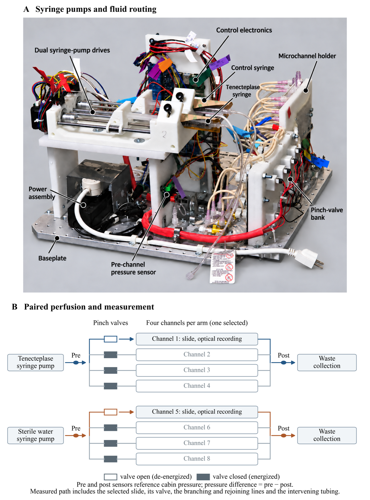</p>

*Top: hardware with labels (the background of the photo was replaced with an image tool for clarity). Bottom: how each paired run is plumbed and measured.*

## 2. Flight operations

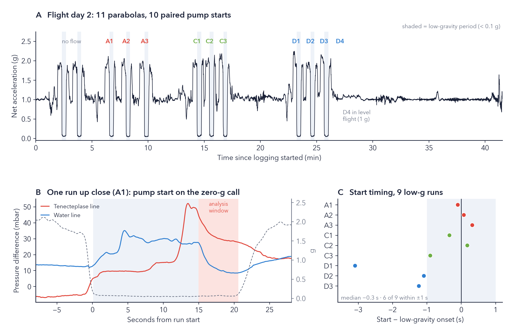

- **A.** The whole flight from the accelerometers: 11 parabolas of about 20 s each below 0.1 g, with 2 g pull-ups on either side. Two were flown without flow to measure how the sensors respond to gravity alone.
- **B.** One run up close. The pump starts on the zero-g call, and the shaded red band marks the seconds used for analysis.
- **C.** Start timing for the 9 runs in microgravity: median 0.3 s before onset, 6 of 9 within ±1 s.

The live operator view during run A1 (pressure on each line, plus the channel camera):

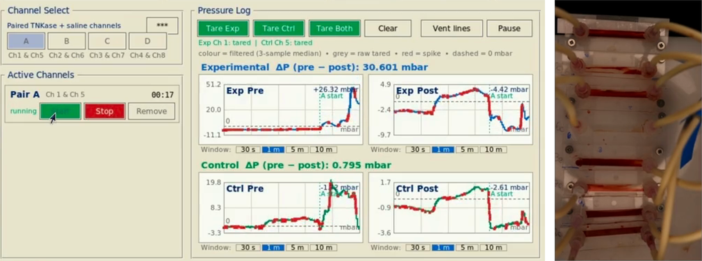

## 3. Results

Only pair A came through with clean imaging *and* clean pressure (pair C leaked, and the camera overheated before pair D), so that pair is the primary analysis.

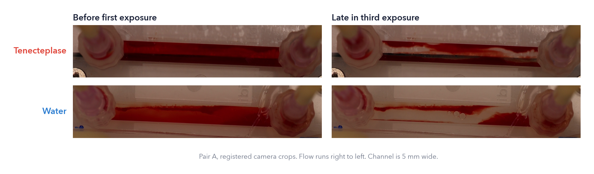

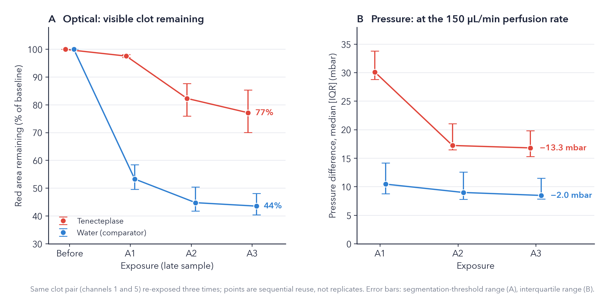

- **Optical:** after three exposures, 77 % of the visible red clot remained in the tenecteplase channel and 44 % in the water channel. Most of the water channel's loss happened in its first push.
- **Pressure:** at the 150 µL/min perfusion rate, the tenecteplase line fell from 30.1 to 16.8 mbar (−13.3) and the water line from 10.5 to 8.5 mbar (−2.0).
- **What this does and doesn't show:** this is one clot pair reused three times, the pressure had not fully settled within the ~5 s windows, and water is hypotonic so it can wash red cells out on its own. The data **do not** establish that tenecteplase worked or that gravity changed anything. What they do show is that the whole measurement chain works in flight, and exactly what limits it.

More detail: [docs/results.md](docs/results.md).

## 4. What the flight taught us

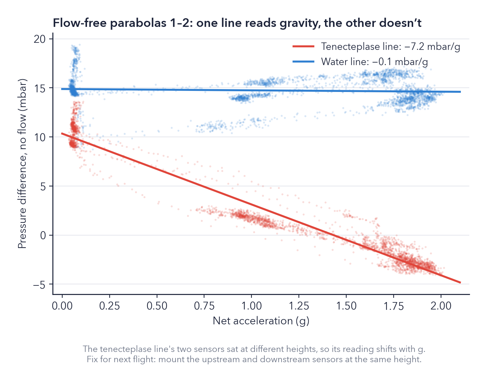

Each limit we hit has a direct fix:

| What happened | Fix for the next flight |
|---|---|
| The first push into a fresh clot drove the upstream sensors past ±100 mbar for 12–18 s | Wider-range pressure sensors |
| One line's sensors sat at different heights, so its reading moved about −7 mbar per g (figure above) | Mount upstream and downstream sensors at equal height |
| Valves closed after each pump stop and trapped line pressure, so the "zero" moved between runs | Record a zero-flow reference in low gravity |
| Water lyses red cells by itself | An isotonic comparator |
| No matched 1 g run and no clot-free baseline | Run the same sequence at 1 g with independent clot preparations |
| Sensor connectors pulled apart under 2 g on flight day 1 | Secure connectors before flight (hot-melt adhesive fixed it for day 2) |

More detail: [docs/lessons-learned.md](docs/lessons-learned.md).

## 5. How I used Claude on this project

Claude (through Claude Code) was part of the team across the build, the flight and the write-up: control software on the Pi, hard safety rules for moving real motors, same-day analysis of the flight log, and a data-checked review of the manuscript. The most useful thing it did was tell me when a result didn't hold up.

Full write-up: [docs/working-with-claude.md](docs/working-with-claude.md).

## 6. In flight

<p align="center">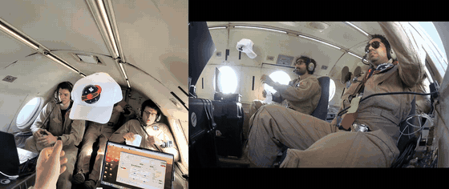</p>

*Zero-g, side by side. Full clip: [media/zero-g_hat-float_side-by-side.mp4](media/zero-g_hat-float_side-by-side.mp4).*

<p align="center">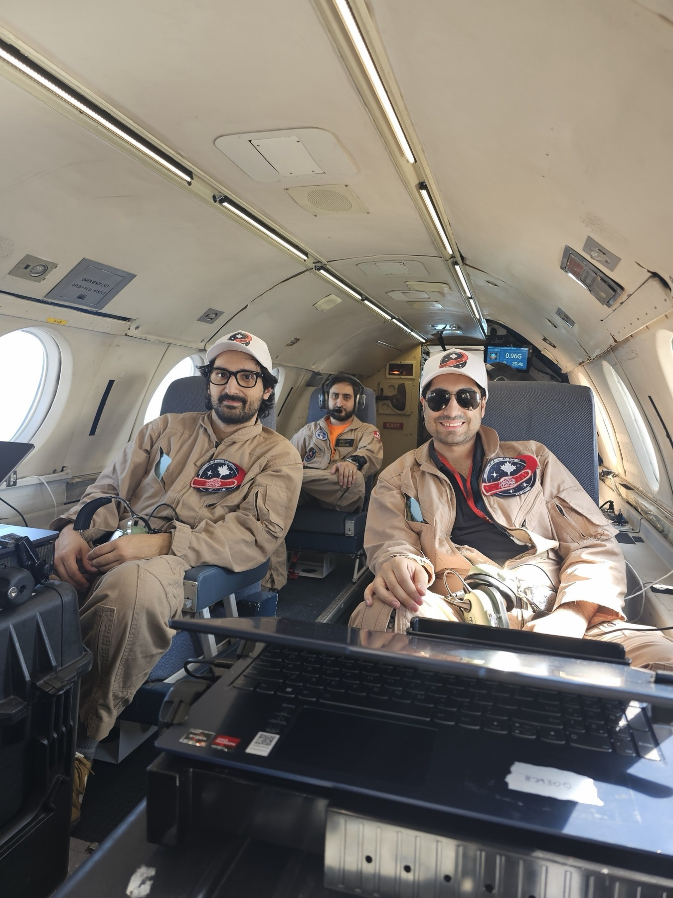 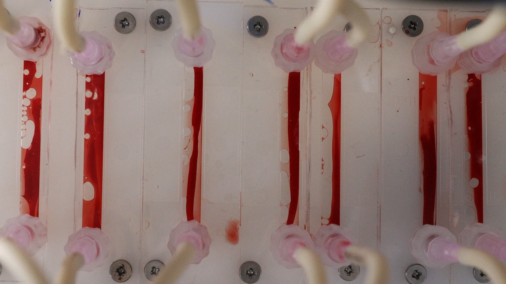</p>

## Presentations and links

- **IAC 2026** (77th International Astronautical Congress, Antalya): oral presentation, 6 October 2026. Paper IAC-26,A1,3,9,x113307. [Listing](https://dl.iafastro.directory/event/IAC-2026/paper/113307/)
- **Journal manuscript:** in preparation.
- **Project website:** [clotless.ca](https://clotless.ca)

## What's in this folder

```
README.md                  this page
poster/                    one-page overview (PNG + PDF) and the logos it uses
figures/                   four result figures, drawn from the flight data
images/                    payload, CAD, platform diagram, in-flight photos, operator view
media/                     zero-g clip (MP4) and a short GIF preview
docs/                      results, lessons learned, working with Claude
```

This folder covers research findings and visuals only. The control software, analysis code and raw flight logs are not included. The raw sensor and event logs are available from the team on reasonable request.

## Team and acknowledgements

Adrian Tabari, Farshad Felfelian, Niyoosha Yoosefi, Mohammad Elahi, Roxanna Tabari and Dr. Matthew Turnock (University of British Columbia, University of Toronto, Royal Columbian Hospital).

Thanks to NRC and SEDS-Canada's CAN-RGX program for selection and flight operations, to ibidi, Pure Integrative Pharmacy, Sensirion, Lions Gate Hospital and Power Print for in-kind support, and to the Royal Columbian Hospital Foundation for funding. The Canadian Space Agency supported presentation of the work at IAC 2026.
