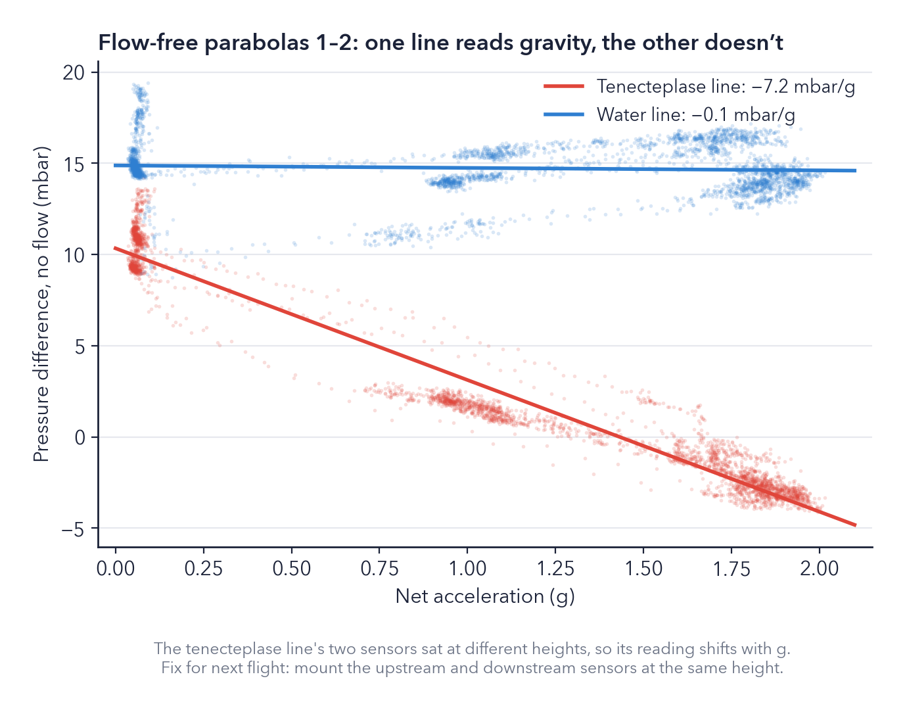

# Lessons learned and strategy

[← Back to overview](../README.md)

A parabolic flight gives you about 20 seconds of microgravity at a time, a floating operator and no second chance on the day. Most of what went well came from designing around that. Most of what went wrong is now a specific fix.

## Operating strategy that worked

**Reduce the operator to two decisions.** Once fluids were primed and clots formed, a run took one click to start (on the zero-g call) and one to stop. Valve sequencing, pump control and logging were automatic. Nine of nine microgravity starts landed close to onset (median 0.3 s early).

**Paired arms in the same maneuver.** Drug and control ran at the same moment, through matched tubing, under the same acceleration. Each perfusate always used the same pump, syringe and sensors, so a difference between arms can't come from swapping hardware.

**Log everything, with no gaps.** Pressure, both accelerometers, pump and valve states and every operator action went into one 20 Hz log. That is what made it possible afterwards to count exactly which seconds were usable and to separate real clot behaviour from artefacts.

**Fly flow-free parabolas on purpose.** The first two parabolas had the valves closed and the pumps off. They turned out to be the cleanest measurement of how each pressure line responds to gravity alone.

**A read-only phone dashboard with one emergency button.** Alongside the full panel on the laptop, we built a phone page that showed live pressures, pumps, valves and a parabola counter. The only things it could do were a hold-to-fire STOP ALL and drop an observation marker into the log. Nothing on it could start a pump.

**Fail-safe by design.** The pinch valves are normally open and the pumps stop when unpowered, so losing power leaves the fluid still instead of pressurised. An aircraft-side hard-wired emergency stop cuts the whole payload.

**Hard rules for moving real motors.** During the ground build, two incidents needed the 24 V supply pulled by hand. They led to fixed rules for any motor motion:

1. Every remote motor command runs under a timeout, because a dropped SSH session can leave a pump running with nobody watching.
2. Never reverse a carriage with stall detection turned off.
3. Always ask the operator where the carriage physically sits before moving it.
4. Power up the computer first and the 24 V supply second, and power down in reverse.

## What the flight exposed, and the fix for each

| Finding | Evidence | Fix |
|---|---|---|
| **Sensor range too small for a fresh clot.** The first push into an untouched clot sent the upstream sensors past ±100 mbar | 16 s and 18 s of over-range on the drug line (C1, D1), 12 s on the water line (D1). Second pushes into the same channels stayed in range | Wider-range pressure sensors |
| **Gravity leaks into one line.** The drug line's two sensors sat at different heights, so its pressure difference shifted with acceleration | About −7 mbar per g on the drug line vs. about 0 on the water line, measured during the flow-free parabolas | Mount upstream and downstream sensors at equal height |
| **The zero moves between runs.** Valves closed 0.5 s after each pump stop and trapped line pressure into the next run | Pre-run baselines ranged from −6 to +40 mbar | Record a zero-flow reference in low gravity on every run |
| **The comparator wasn't neutral.** Sterile water lyses red cells by itself | The water channel lost most of its red area in the first exposure | An isotonic comparator |
| **Windows too short to settle.** About 5 s of perfusion-rate data per parabola, with settling times of 0.6–2.9 s | Pressure was still falling at the end of every window | Longer usable windows per parabola, and longer-duration platforms for time courses |
| **No 1 g reference.** Nothing to compare microgravity against | Only one run (D4) happened at 1 g, after earlier exposures | A matched 1 g run of the same sequence, with independent clots |
| **Hardware under 2 g.** Connectors separated on day 1, pair C leaked, and the camera overheated before pair D | Day 1 produced no usable data | Secure every connector before flight, leak-test under load, and manage camera heat |
| **One pump had a once-per-turn flow ripple.** Bench tests found flow on pump 2 swelling once per lead-screw revolution | Autocorrelation peak at exactly one revolution (124 s at 60 µL/min, about 50 s at 150 µL/min). Pump 1 showed none | Check the lead screw and nut for runout |

## The broader takeaway

The question CLOT-LESS set out to answer is still open. What the flight did answer is whether it can be measured at all in 20-second windows, and what to change so the next flight can answer the science question. Both the drug and gravity questions need replicates, an isotonic comparator and a 1 g run of the identical sequence. The platform is ready for that.
