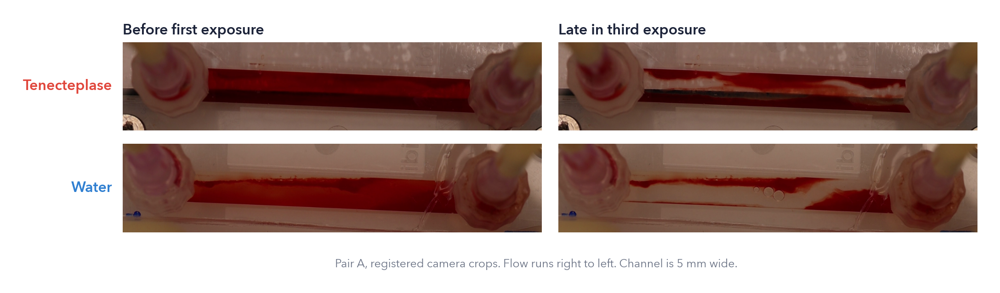
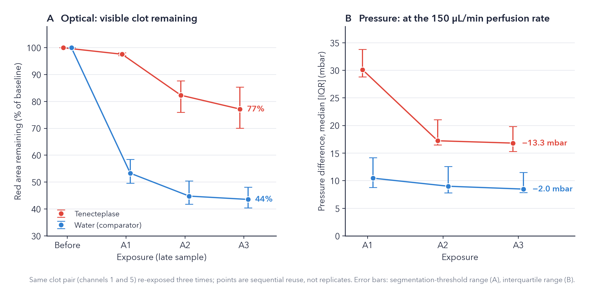

# Results in detail

[← Back to overview](../README.md)

All numbers come from flight day 2 (2 September 2026). On day 1, the sensor connectors pulled apart during the first 2 g pull-up and no usable data were recorded. They were secured with hot-melt adhesive overnight.

## Flight operation

| Measure | Result |
|---|---|
| Parabolas flown | 11 (about 20 s each below 0.1 g, mean residual 0.03 g) |
| Pull-up loads | about 2 g (1.96–2.24 g, one-second medians) |
| Paired pump starts | 10 commanded, 10 executed as programmed |
| Starts in microgravity | 9 (the 10th, D4, ran in level flight at 1 g) |
| Start timing vs. zero-g onset | median 0.3 s early, range 3.1 s early to 0.3 s late |
| Log | 49,679 rows at 20 Hz over 41.5 min |
| Gaps in the sample sequence | 0 (longest interval 83 ms, no missed accelerometer samples) |
| Lost pressure samples | only when an upstream sensor went over its ±100 mbar range during the first push into a fresh clot (C1 and D1) |

The two flow-free parabolas at the start were deliberate. With all valves closed and the pumps off, they show how each pressure line responds to gravity alone (see [lessons learned](lessons-learned.md)).

## Data recovery by channel pair

| Pair | Channels (drug / water) | Runs | What came back |
|---|---|---|---|
| A | 1 / 5 | 3 | Imaging and pressure, no leak. **Primary analysis.** |
| B | 2 / 6 | 0 | Not run. One clot washed out during the pre-flight patency check |
| C | 3 / 7 | 3 | Imaging and pressure, but channel 3 leaked |
| D | 4 / 8 | 4 | Pressure only. The camera overheated, and both upstream sensors went over range in D1 |

Pair A had 60.1 s of pump-active low gravity across its three exposures. After keeping only the seconds where both arms were at the perfusion rate and both pressure lines were valid, 15.2 s remained (windows of 4.6–5.6 s).

## Optical result (pair A)

Red area remaining, as a percentage of each channel's own baseline:

| Late sample | Tenecteplase (ch 1) | Water (ch 5) |
|---|---|---|
| A1 | 98 % | 53 % |
| A2 | 82 % | 45 % |
| A3 | 77 % | 44 % |

- The water channel lost most of its red area during the first exposure, before any pressure window began.
- The tenecteplase channel barely changed in A1, then dropped in abrupt steps during A2 and A3. Steps look more like fragments being displaced than gradual lysis.
- Pale material stayed behind in both channels, which fits red cells leaving a matrix that persists. Its composition was not tested.
- The larger drop in the water channel held up under different segmentation thresholds and sampling times.

## Pressure result (pair A)

Pressure difference across the channel at the 150 µL/min perfusion rate, median [interquartile range]:

| Exposure | Window | Tenecteplase (mbar) | Water (mbar) |
|---|---|---|---|
| A1 | 5.6 s | 30.1 [28.8–33.8] | 10.5 [8.8–14.2] |
| A2 | 4.6 s | 17.2 [16.5–21.1] | 9.0 [7.8–12.6] |
| A3 | 5.0 s | 16.8 [15.3–19.8] | 8.5 [7.8–11.5] |
| **Change** | | **−13.3** | **−2.0** |

- Pressure settled with time constants of 0.6–2.9 s, which is about the same length as the windows, so the readings were still falling at the end of each one.
- Most of the pressure difference built up upstream of the clot. The downstream sensor carried only about a tenth of it.

## How to read this

The platform did what it was built to do. It ran paired drug-and-control perfusions on cue in microgravity and logged everything needed to say exactly which seconds were usable.

The biology is exploratory. One clot pair was reused three times, so the points are a sequence, not replicates. The comparator was sterile water, which is strongly hypotonic and can strip red cells by itself. And there was no matched 1 g run. **These observations do not establish tenecteplase efficacy or a gravity effect.**

An early analysis right after the flight pooled all three pairs and showed a larger drop on every tenecteplase channel. That view was dropped once the leak in pair C, the missing video for pair D and the sensor saturation were fully accounted for. The conservative pair-A result above is the one we stand behind.
